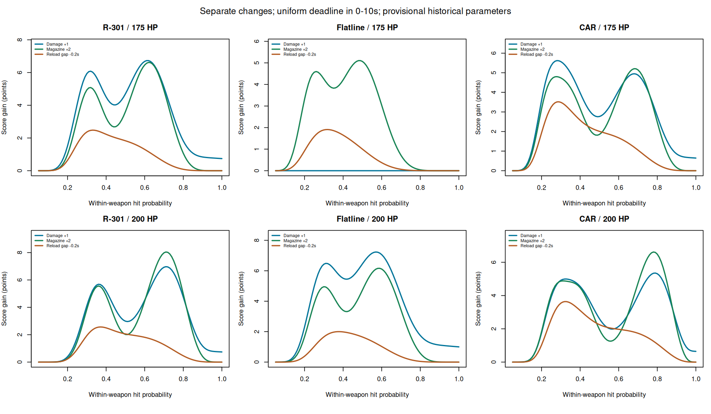
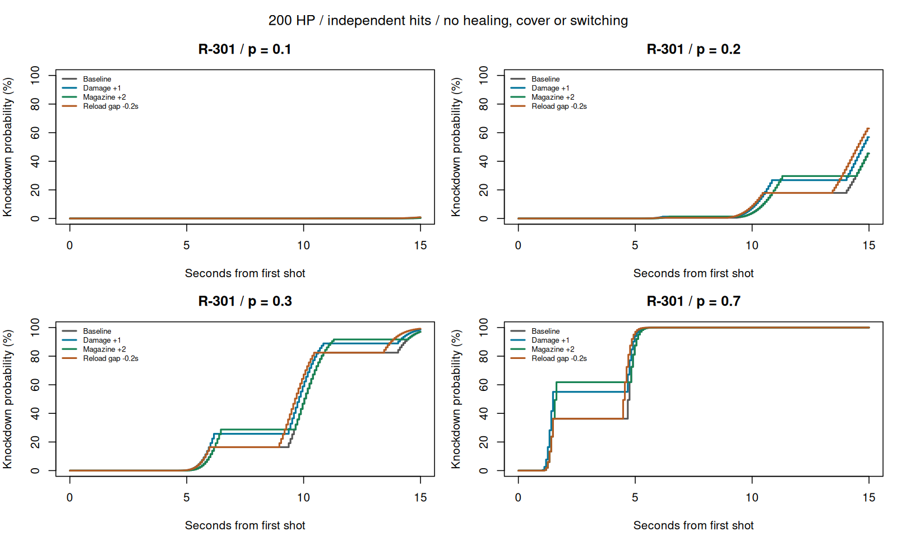

# Apex Weapon Adjustment Sensitivity

A reproducible stochastic analysis of **within-weapon balance changes**, conditional on accuracy and an explicit time horizon. Implemented in base R, with analytical probabilities and Monte Carlo verification.

**研究问题：同一把武器的伤害、弹匣和换弹调整，在什么命中率和时间范围内最有效？**

本项目将 R-301、Flatline、CAR 作为三个独立案例。它不假设玩家使用不同武器时命中率相同，不提供跨武器强弱总榜，也不预测玩家胜率或段位。

## Quick start / 运行

Requires R >= 4.3; no additional packages or network access required.

```sh
Rscript run.R
```

Windows：先完整解压项目，打开 `ApexSensitivity.Rproj`，再打开 `run.R`，点击 **Source** 运行整个文件。不要只选中函数内部的一行执行。图表与结果写入 `output/`，不一定出现在 RStudio 的 Plots 面板。

运行会重建结果并执行测试；失败时停止。GitHub Actions 在 push / pull request 时执行相同命令。完整计算通常只需几十秒，取决于电脑性能。

## Final model / 最终模型

对给定武器，固定身体伤害 d、射速 r（发/秒）、弹匣容量 m 和换弹间隔 g。目标有效生命值 H，独立单发命中概率 p。第一发发生在 t=0。

所需命中数 n=ceil(H/d)。击倒所需总射击次数 K=n+NegativeBinomial(n,p)，负二项随机变量表示第 n 次命中之前的未命中次数。

第 k 发的时间为：

```text
t(k) = (k-1)/r + floor((k-1)/m) * (g-1/r)
T = t(K)
```

**g 是前一弹匣最后一发到下一弹匣第一发的间隔**；不等同于所有网站所列的换弹动画时间。当前使用空仓换弹报告值作近似，尚未逐帧实测。

最终评分为：

```text
S_tau(p) = 100/tau * integral_0^tau P(T <= t | p) dt
         = 100 * E[max(tau-T,0)] / tau
```

评分范围 0–100。可理解为截止时间均匀分布在 [0,tau]、且独立于射击过程时，截止前完成击倒的概率乘以 100。它也等于截断平均击倒时间的标准化补数。**均匀截止时间是设计情景，不是实测交战时长分布。** 默认展示 tau=10 秒，并同时计算 5、8、15 秒检验敏感性。不同 tau 的分数不能当作同一尺度的武器强度直接比较。

配套指标：一梭子击倒概率、平均击倒时间、完整击倒时间累计概率曲线。模型推导见 [METHODS](docs/METHODS.md)。

## Experiments / 实验设计

| 输入 | 设定 |
|---|---|
| 武器 | R-301、Flatline、CAR，分别分析 |
| 命中率 | 0.05–1.00，步长 0.01 |
| 有效生命值 | 150、175、200、225 |
| 调整 | 伤害 +1；弹匣 +2；换弹间隔 −0.2 秒 |
| 截止时间上限 | 5、8、10、15 秒 |
| 命中相关性补充分析 | rho=0、0.05、0.10；只分析一梭子概率 |

三项调整分别进行，不叠加，也不视为等成本设计方案。H=225 等取值是控制情景，不代表所有目标版本都普遍存在该生命值。输入是部分重建的历史参考，**不是经完整核验的 S24 或当前版本武器快照**。完整来源见 [SOURCES](docs/SOURCES.md)。

## Main results / 主要结果



R-301，200 HP，0–10 秒均匀截止时间：

| p | 基准评分 | 伤害 +1 增益 | 弹匣 +2 增益 | 换弹 −0.2 秒增益 |
|---|---:|---:|---:|---:|
| 0.30 | 7.76 | 4.12 | 3.86 | 1.93 |
| 0.70 | 63.89 | 6.93 | 7.98 | 1.27 |

这不是跨武器排名。即使同一把武器，方案的相对收益也会随命中率改变。对于这两档 p，在 8、10、15 秒范围下，上述方案顺序保持一致；不宣称在整个参数空间内都一致。

1. **整数击倒门槛产生非线性收益。** Flatline 从 18 增至 19 伤害，在 175 HP 下仍需 10 次身体命中，因此本模型下击倒时间分布完全不变；200 HP 下则从 12 次降到 11 次。
2. **增益峰值可以解释。** 当伤害增加使命中门槛从 n 降到 n−1，且 n−1<=m，一梭子概率增益等于 Binomial(m,p) 在 n−1 处的概率质量；峰值 p=(n−1)/m。200 HP 下，三案例峰值分别约 71.4%、57.9%、78.9%。它们不是实测玩家命中率。
3. **固定时间点可能掩盖弹匣优势。** R-301 在 p=0.3 时，弹匣 +2 在恰好 5 秒和 10 秒的概率增益为零，因为两种配置在这些时间点的累计射击数相同；8 秒时则有明显优势。
4. **低命中率下平均省时可能具有误导性。** R-301 在 p=0.1 时伤害 +1 平均省约 2.23 秒，但两个配置的 5 秒内击倒概率均极低。必须同时查看有限时间指标。
5. **有限时间评分可出现多个峰值。** 不同命中率会让击倒集中在不同弹匣阶段，积分评分因而可呈现多个局部峰值；一梭子概率的单峰解析公式不能直接用于综合评分。
6. **相关性改变增益幅度。** R-301、200 HP、平均 p=0.7 时，伤害 +1 的一梭子概率增益在 rho=0、0.05、0.10 下约为 18.78、13.00、10.22 个百分点。这是敏感性分析，rho 未由实战估计。



## External reference / 外部参考

网站历史评分用于检查模型遗漏因素，不能当作真实标签。S24 标题的 esports.gg 榜单给 R-301 / Flatline / CAR 为 C / B / B，bo3.gg 为 A / A / C。前者包含赛季中期变化；两者未建立精确补丁匹配，更不是同一网站的前后配对。具体解释与证据限制见 [EXTERNAL_REFERENCE](docs/EXTERNAL_REFERENCE.md)。

先前抽取的一天 ALGS 数据有 shots / hits，但粒度为全场武器汇总。缺失占位符、不同射击目的、交战切分缺失和版本未确认，使其不能直接校准本模型 p 或 rho。本项目不使用这些比例拟合参数，不分发玩家原始数据。

## Verification / 验证

`run.R` 执行 96 个独立命中情景，每个模拟 100,000 次，检查平均时间和评分；另外核对积分恒等式、p=1 的确定时间、换弹收益恒等式、两组 beta-binomial 模拟。详细记录保存在 `output/validation.txt` 和 `output/simulation_checks.csv`。

模拟和公式共享建模假设，吻合只验证实现一致性，**不构成实战有效性证明**。

## Scope and value / 意义与边界

本项目适合作为游戏数值策划的可解释敏感性分析：显示哪些条件下调整有效、收益来自什么机制、结论依赖哪些假设。当前不支持真实全武器排名、版本因果结论或天梯胜率预测。完整限制与后续验证要求见 [LIMITATIONS](docs/LIMITATIONS.md)。

## Project structure

```text
run.R                      Reproduce analysis and tests
R/model.R                  Core probability and scoring functions
data/weapons.csv           Explicit scenario inputs
data/source_audit.csv      Parameter provenance and uncertainty
data/historical_ratings.csv External opinion references
tests/checks.R             Analytical / simulation checks
docs/                      Derivation, sources, interpretation, limitations
output/                    Reproducible tables, plots and validation logs
.github/workflows/          Automated reproduction
```

Prepared 2026-10-26. Unofficial research project; not affiliated with EA or Respawn. External text and game assets are not redistributed. No software license has been selected; choose one before granting reuse rights.
